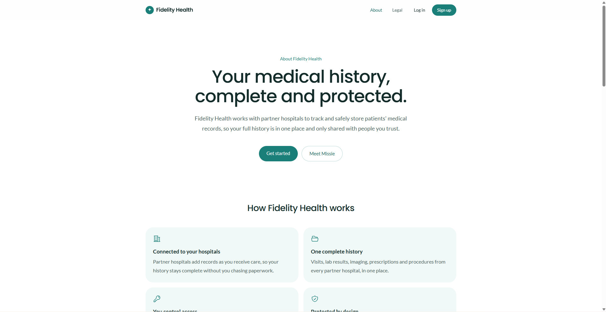
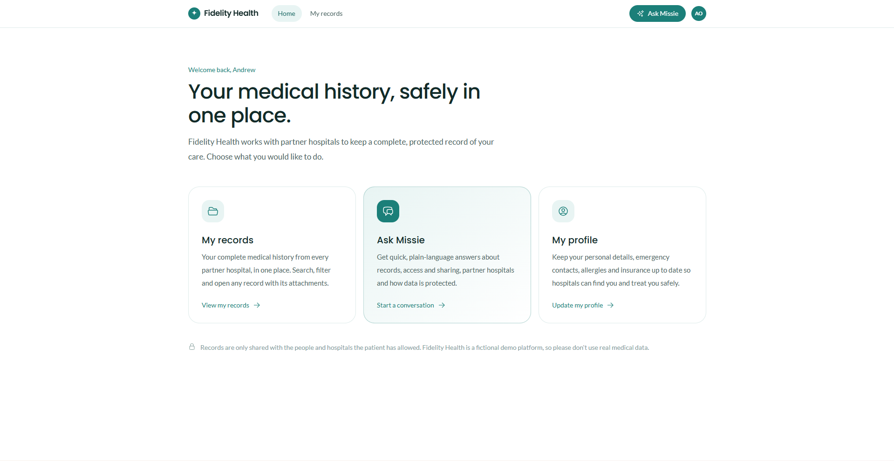
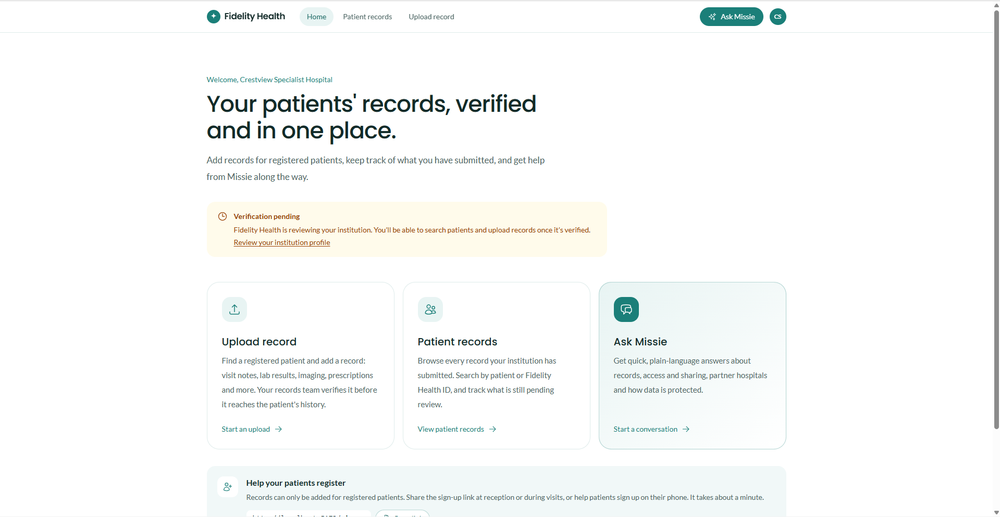
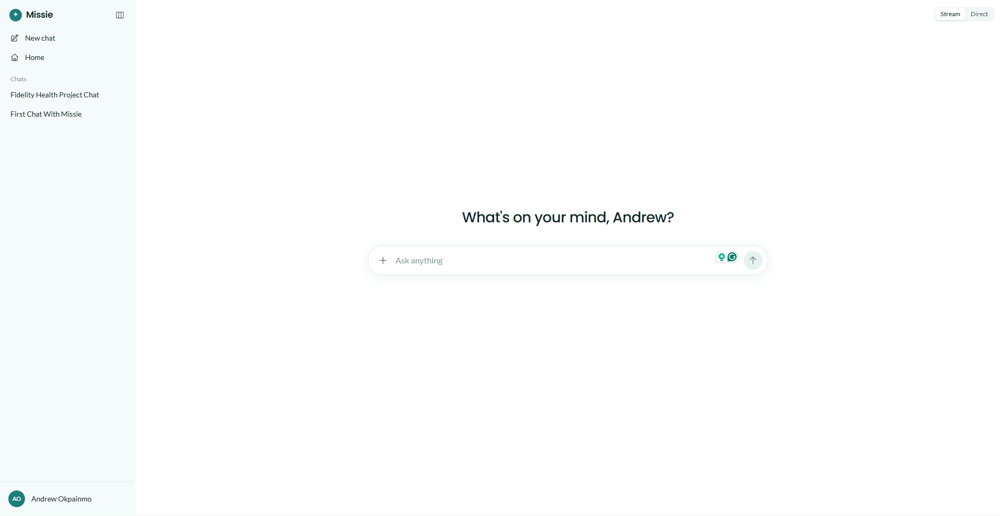
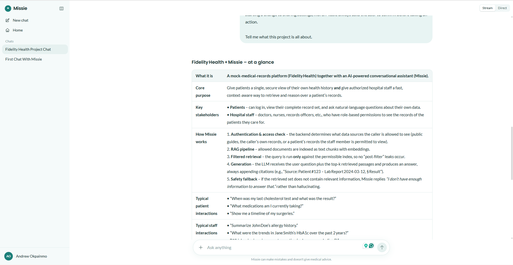

# Fidelity Health

**Fidelity Health** is a mock medical-records platform. It partners with hospitals to track, store and protect patients' medical record history. Hospital records officers upload records, and patients see their complete history in one place.

**Missie** is Fidelity Health's AI assistant, for patients and hospital staff. It answers from Fidelity Health's guides and policies and, depending on the user's access rights, from uploaded medical records, using retrieval-augmented generation (RAG). Patients can ask about their own history. Doctors and other staff with access can chat about a patient's records, for example to support a diagnosis. It is planned to grow into an agentic assistant that can take simple actions on a user's behalf.

> **Demo project.** Fidelity Health and its partner hospitals are fictional, and this is a learning build from the _AI Course for Developers_. Missie's answers are decision support for the clinician, not medical advice or a diagnosis, and nothing here should be used for real health decisions. Don't enter real medical data.



## Screenshots

| Patient home | Hospital home |
| --- | --- |
|  |  |
| Patients see their records, chat with Missie and keep their profile up to date. | Hospitals upload records for registered patients and track what they've submitted. Uploading unlocks once Fidelity Health verifies the institution. |

**Chatting with Missie**

| New chat | A reply |
| --- | --- |
|  |  |
| Saved conversations sit in the sidebar. The **Stream / Direct** toggle at the top right sets whether replies stream in or arrive whole. | Replies are rendered as Markdown, including tables, lists and code. |

## Status

| Area                         | State                                                                   |
| ---------------------------- | ----------------------------------------------------------------------- |
| Accounts (sign up, log in)   | Working, against the server's auth endpoints                            |
| Account types                | Working: patient and institution (hospital) accounts, stored on the server as `accountType` |
| Profiles (patient and institution) | Working: stored on the server and saved from the profile pages |
| Medical records              | Working: verified hospitals find registered patients and upload records with attachments (S3); the hospital verifies or rejects each one; patients see theirs |
| Profile photos               | Working: patients' passport photos, stored in S3 |
| Admin dashboard              | Working: `/admin` for Fidelity Health staff, covering an overview, institution verification, user accounts and all records |
| Chat interface               | Working: conversations are saved on the server; replies stream in or arrive whole, set per profile (`chatMode`) |
| AI responses                 | Working: an OpenAI-compatible model (Amazon Bedrock); no knowledge base yet |
| RAG (knowledge base, search) | Not built yet                                                           |
| Access-based record retrieval (patients, hospital staff) | Not built yet                                  |
| Record access log            | Not built yet                                                           |
| Agentic actions (tools)      | Not built yet                                                           |
| About and legal pages        | Done: about page with FAQ; drafts of the privacy policy, terms, medical disclaimer, AI use and cookie pages |

## How Missie is meant to work

Missie uses a standard RAG (retrieval-augmented generation) pipeline. What it can draw on depends on who is asking and what access they have.

1. **A signed-in user asks a question.** This can be a patient, or hospital staff (doctors, records officers and other agents).
2. **The server checks access first.** It works out which sources this user may see:
   - everyone: Fidelity Health's guides, policies and FAQs;
   - a patient: their own records;
   - hospital staff: the records of patients their access rights cover, and nothing else.
3. **Records are searchable.** When a record is uploaded, its text (including text from attachments) is split into chunks, embedded and indexed with the patient and hospital it belongs to.
4. **Retrieval only searches what the user is allowed to see.** The access filter is applied before the search runs, not to the results afterwards. The most relevant passages then go to the model along with the question.
5. **Missie answers from that context and cites its sources** (the records or documents it used). When the sources don't cover a question, it says so instead of guessing.
6. **Clinicians can chat about a patient.** For example, a doctor with access could ask for a summary of a patient's history, current medications and allergies, or trends across past results, or ask which past findings relate to a new symptom. Missie supports the clinician's judgement during diagnosis; the clinician makes the decision.
7. **Patients can ask about their own history**, for example "When was my last blood test, and what did it show?"
8. **Every record lookup is logged** (who asked, which patient, when). Patients can see who has queried their records.
9. **Agentic tooling** Examples include requesting a copy of records, showing the access log, or starting a change to sharing settings, more. Missie always asks the user to confirm before taking an action.

## Repository layout

This is a [Bun workspace](https://bun.com/docs/install/workspaces) with two packages:

```
packages/
  client/   React + Vite web app (home, records, upload, Missie chat, auth, about and legal pages)
  server/   Express + TypeScript API (auth, users, admin, Missie chat; RAG and record retrieval to come)
```

- [packages/client/README.md](packages/client/README.md): client structure, state management and routes.
- [packages/server/README.md](packages/server/README.md): API endpoints, environment and database setup.

## Tech stack

- **Client:** React 19, Vite, Tailwind CSS 4, Redux Toolkit, React Router, Axios.
- **Server:** Node.js, Express 5, TypeScript, Zod, Prisma (PostgreSQL), JWT sessions with an http-only cookie, a built-in WebSocket server.
- **Tooling:** Bun (package manager and workspaces).

## Getting started

### Prerequisites

- [Bun](https://bun.com)
- Node.js (the server's dev script uses `tsx`)
- PostgreSQL. The development settings expect it on `localhost:5433`.

### 1. Install dependencies

From the repository root:

```bash
bun install
```

### 2. Configure the server

The server reads `packages/server/.env` to pick the environment, then the matching file (for example `.env.development`). Copy the sample if you don't have one yet:

```bash
cp packages/server/.env.development.sample packages/server/.env.development
```

Set `POSTGRES_DATABASE_URL`, `JWT_SECRET` and the `DATABASE_TYPE_*` values. See the server README for every variable.

### 3. Run database migrations

From `packages/server`:

```bash
bunx dotenv -e .env.development -- bunx prisma migrate deploy
```

### 4. Start the server

```bash
cd packages/server
bun run dev
```

The API runs on `http://localhost:5000` (from `PORT`), under `/api/v1`.

### 5. Start the client

```bash
cd packages/client
bun run dev
```

Open `http://localhost:5173`. The server only accepts browser requests from port 5173 in development (see `allowedOrigins` in `packages/server/src/app.ts`).

The client reads the API address from `VITE_API_URL_BASE` in `packages/client/.env.development`.

## Pages

| Path                       | Access     | Purpose                         |
| -------------------------- | ---------- | ------------------------------- |
| `/login`                   | Signed out | Log in (patients and institutions) |
| `/signup`                  | Signed out | Patient sign-up                 |
| `/signup/hospital`         | Signed out | Hospital / institution sign-up  |
| `/`                        | Signed in  | Home; actions differ by account type |
| `/records`                 | Signed in  | Patients: My records. Institutions: Patient records |
| `/records/upload`          | Verified institutions | Upload a record for a registered patient |
| `/records/:id`             | The record's patient or hospital, admins | Record detail with attachments; the hospital verifies or rejects it here |
| `/admin` and sub-pages     | Admins     | Overview, institutions (verification), users, all records |
| `/profile`                 | Signed in  | My profile (patient) or Institution profile |
| `/missie/chat`, `/missie/chat/:id` | Signed in | Chat with Missie (old `/chat` links redirect) |
| `/settings`                | Signed in  | Account details and log out     |
| `/about`                   | Public     | About Fidelity Health and Missie |
| `/legal` and its sub-pages | Public     | Privacy, terms and other notices |
